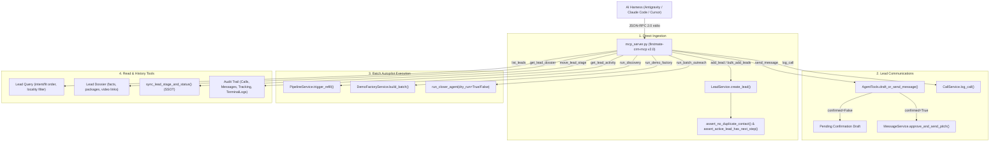

# PersonalOS & CRM - MCP Tools Overhaul & SSOT Service Integration

**Date:** 2026-11-16
**Branch:** `feature/mcp-tools` (from `main`, with `fix/ai-features` merged)
**Protocol:** Model Context Protocol (MCP) `2024-11-05` (JSON-RPC 2.0 over `stdio`)
**Server Version:** `firstmate-crm-mcp` v2.0.0

---

## 1. Problem Statement & Motivation

Prior to this overhaul, `projects/PersonalOS and CRM/backend/mcp_server.py` exposed legacy agent wrappers (`run_scout_agent`, `run_auditor_agent`, `run_closer_agent`, `run_refill_batch`) that:
1. Did not support direct, high-fidelity lead ingestion with deduplication.
2. Lacked dry-run safety gates on lead communication tools.
3. Did not expose targeted discovery with preset localities, custom search queries, and `stop_after` pipeline stages aligned with the Autopilot Cockpit.
4. Lacked access to comprehensive lead activity timelines (call logs, message history, tracking webhooks, and terminal telemetry).
5. Were decoupled from modern FastAPI single-source-of-truth (SSOT) services (`LeadService`, `CallService`, `AgentTools`, `PipelineService`, and `DemoFactoryService`).

---

## 2. Architectural Design & SSOT Service Mapping

All MCP tools execute within isolated `SessionLocal()` transactional blocks and delegate directly to canonical backend domain services:

---

## 3. Comprehensive MCP Tools Inventory (v2.0.0)

| Tool Name | Category | Primary Parameters | Under-the-Hood Service | Safety / Invariants |
| :--- | :--- | :--- | :--- | :--- |
| `add_lead` | Direct Ingestion | `name`, `doctor_name`, `locality`, `primary_phone`, `email`, `instagram_handle`, `preferred_channel`, `next_action`, `deal_value_inr` | `LeadService.create_lead` | Deduplication check on phone/IG; auto-generates slug; assigns default next action due date. |
| `bulk_add_leads` | Direct Ingestion | `leads` (list of lead objects), `hustle_id` | `LeadService.create_lead` per item | Atomic rollback per item; returns structured summary with `created_count`, `skipped_count`, and skip reasons. |
| `send_message` | Communications | `lead_id`, `text`, `channel`, `confirmed` | `AgentTools.draft_or_send_message` | **Strict safety gate**: `confirmed=False` returns pending confirmation draft payload; `confirmed=True` transmits via outbox. |
| `log_call` | Communications | `lead_id`, `raw_text`, `duration_seconds`, `outcome` | `CallService.log_call` via `AgentTools.log_call` | Creates structured call log, AI prep brief, next steps, and updates lead touchpoint. |
| `run_discovery` | Batch Execution | `locality`, `limit`, `stop_after`, `hustle_id` | `PipelineService.trigger_refill` | DB lock check (`_db_assert_no_active_run`); supports 27 Delhi NCR preset localities and `stop_after` stages. |
| `run_demo_factory` | Batch Execution | `batch_id`, `batch_size`, `testing_mode`, `hustle_id` | `DemoFactoryService.build_batch` | Scaffolds website payloads, runs validation gates, and triggers Playwright video recording. |
| `run_batch_outreach` | Batch Execution | `channel`, `batch_id`, `dry_run`, `clinic_id`, `hustle_id` | `run_closer_agent` | Defaults to `dry_run=True`; enforces daily channel quotas and OPD schedule windows. |
| `list_leads` | Read & History | `stage_id`, `locality`, `search`, `limit`, `hustle_id` | Direct SQLAlchemy query on `Lead` | Substring search on name, doctor, locality, phone; ordered by `intent_score desc, fit_score desc`. |
| `get_lead_dossier` | Read & History | `lead_id` | Relational query on `Lead` | Returns contact details, stage, status, demo URL, verified `facts`, and `packages`. |
| `move_lead_stage` | Read & History | `lead_id`, `stage_id`, `next_action` | `sync_lead_stage_and_status` (SSOT) | Atomically syncs `lead.stage_id` and denormalized `lead.status` string; updates next action note. |
| `get_lead_activity` | Read & History | `lead_id`, `limit` | Queries `Call`, `Message`, `TrackingEvent`, `TerminalLog` | Provides unified chronological audit trail and activity telemetry. |

---

## 4. Removed Obsolete Tools
The following legacy wrappers were completely removed from `TOOLS` and tool dispatch:
- `run_scout_agent`: Replaced by `run_discovery` and `add_lead`.
- `run_auditor_agent`: Replaced by `run_demo_factory` (which runs audit gates and video recording natively).
- `run_closer_agent`: Replaced by `run_batch_outreach` (supporting batch IDs and clinic targeting) and `send_message`.
- `run_refill_batch`: Replaced by the upgraded `run_discovery` tool.

---

## 5. Verification & Testing

A dedicated test suite was added in `tests/backend/test_mcp_server.py`:
- `test_mcp_tools_list`: Asserts all 11 new tools exist and all 4 obsolete tools are removed.
- `test_mcp_initialize`: Verifies MCP JSON-RPC protocol handshake (`2024-11-05`, server name and version).
- `test_mcp_add_and_list_leads`: Verifies single lead creation with auto-slugging and search retrieval.
- `test_mcp_bulk_add_leads`: Verifies bulk ingestion with duplicate contact handling.
- `test_mcp_send_message_safety`: Verifies safety gate behavior (`confirmed=False` vs `confirmed=True`).
- `test_mcp_log_call_and_activity`: Verifies call logging and full activity audit stream retrieval.
- `test_mcp_move_lead_stage`: Verifies atomic stage and canonical status synchronization.
- `test_mcp_get_lead_dossier`: Verifies comprehensive dossier retrieval.

All 8 tests pass cleanly (100% success rate).
